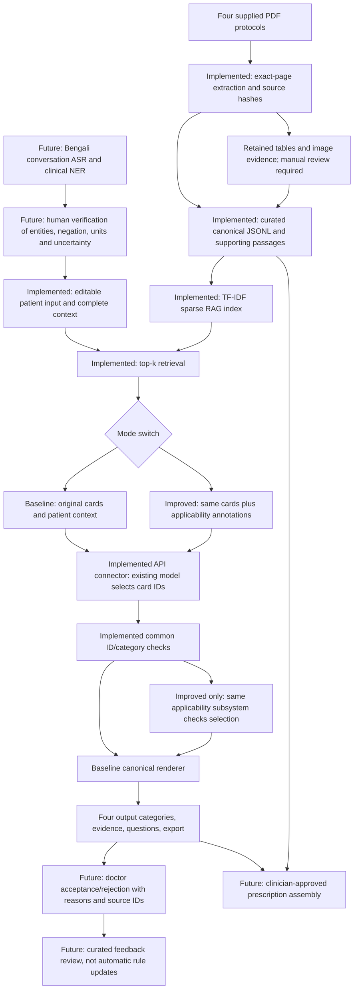

# Question 3 — System architecture

Implemented means written and software-tested to the extent reported in BUILD_STATUS.json. It does not imply that live API integration, visual source review or clinical validation has occurred. The source-card dataset is AI-curated. The full hypertension algorithm is not yet implemented.

## Why this design?
For a small, fixed protocol corpus, JSONL makes conditions and provenance inspectable. Character TF-IDF avoids downloading an embedding model and is fast enough to rebuild. It misses semantic/cross-language matches and can retrieve the wrong protocol. A future retrieval study could compare bilingual dense retrieval, but that is not combined with the current experiment.

Compared with simply chunking PDF text, canonical cards preserve one recommendation and its linked prerequisites, exceptions, timing and source references. This requires manual curation and can introduce transcription mistakes, so retain evidence and review cards against the source.

## New detail changes the plan
Re-run with the complete updated patient record. In C3→C6 only pregnancy changes, so the cholera antibiotic OR rule becomes true while the no-dehydration ORS branch remains unchanged. Do not silently carry forward a prior treatment decision after context changes.

## Model and safety boundaries
The model chooses relevant cards; canonical rendering limits invented action wording. Citation integrity is not evidence entailment. The model can select an irrelevant card, miss a needed card, hallucinate a supporting reason or misclassify a diagnosis. The applicability checker can only evaluate encoded rules and entered structured facts. It cannot prove safe prescribing.

## Future integrations
NER results join the patient record after verification; do not train NER for this assessment. Doctor acceptance/rejection should link case/output/card/source IDs and reason, not automatically rewrite guidelines. Prescription assembly must require a clinician-approved drug selection and complete patient-specific medication fields. Source IDs accompany every stage to preserve traceability.

## Cost/latency trade-off
One model call per case per mode; improved adds no extra LLM call but adds CPU rule checks and prompt annotation tokens. Top-k=16 can produce a large context because full-page passages are retained. Smaller evidence spans after manual review would reduce tokens/latency, but changing spans between modes would confound the comparison. Log actual response time, token usage where available and model/version. Record costs separately if the provider supplies prices. Do not invent cost figures.
